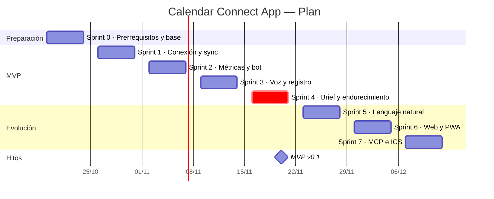

# 01 · Plan de trabajo

## 1. Supuestos de planificación

- Sprints de **1 semana** (lunes a viernes). Capacidad: **~20 puntos por sprint**, desarrollo asistido por IA, dedicación parcial.
- Fecha de inicio: **lunes 2026-10-19** (Sprint 0). Verificar festivos de Colombia en noviembre, que pueden recortar sprints.
- Ruta corta: si se dedica tiempo completo y se difieren HU-21, HU-33 y HU-34, el MVP puede estar listo en ~3 semanas.
- Los puntos de cada sprint están en `04-historias-de-usuario.md`.

## 2. Hitos y versiones

| Hito                         | Fecha objetivo      | Contenido                                                  | Criterio de salida                                    |
| ---------------------------- | ------------------- | ---------------------------------------------------------- | ----------------------------------------------------- |
| H0 · Listo para programar    | 2026-10-23          | Prerrequisitos `05` + repo y Docker                        | `docker compose up` sano; credenciales validadas      |
| H1 · Datos conectados        | 2026-10-30          | OAuth, calendarios, Registro, sync                         | Eventos de todos los calendarios en BD sin duplicados |
| H2 · Métricas confiables     | 2026-11-06          | Horas de reunión, bloques libres, `/hoy` `/libre`          | Resultados = cálculo manual en casos de prueba        |
| H3 · Voz y registro          | 2026-11-13          | Notas de voz, registrar actividad, crear eventos           | Flujo "acabo de tener un daily" E2E sin duplicados    |
| **H4 · MVP v0.1**            | **2026-11-20**      | Resumen matutino, preparación, auditoría, respaldo, costos | Una semana de uso real sin intervención manual        |
| H5 · v0.2 Asistente completo | 2026-11-27          | Lenguaje natural, modificar/cancelar, recordatorios        | Pruebas de confirmación y expiración en verde         |
| H6 · v0.3 Web/PWA            | 2026-12-04          | Vista web, panel, PWA                                      | Instalable en el móvil y accesible por red privada    |
| H7 · v0.4 MCP + ICS          | 2026-12-11          | MCP, ICS directo, cierre del día                           | Cliente MCP opera la agenda con las mismas reglas     |
| Fase 3                       | 2027-01 en adelante | Asana, GitHub, Slack, Jenkins, Graph                       | Por demanda                                           |

## 3. Plan por sprint

### Sprint 0 · 19–23 oct · Preparación (6 pts + trabajo de cuentas)

- Completar el checklist **PRE-01 a PRE-16** de `05`.
- HU-01 Repositorio base · HU-02 Docker Compose.
- **Salida:** H0.

### Sprint 1 · 26–30 oct · Conexión (21 pts)

HU-03 CI/CD (3) · HU-04 OAuth Google (5) · HU-05 Calendarios y categorías (3) · HU-06 Calendario Registro (2) · HU-07 Sincronización (8).

- **Salida:** H1.

### Sprint 2 · 2–6 nov · Métricas y bot básico (21 pts)

HU-11 Configuración (3) · HU-09 Horas de reunión (5) · HU-10 Bloques libres (5) · HU-12 Bot autorizado (3) · HU-13 Comandos (5).

- **Salida:** H2.

### Sprint 3 · 9–13 nov · Voz y registro (21 pts)

HU-15 Notas de voz (5) · HU-16 Registrar actividad (8) · HU-17 Crear eventos (5) · HU-32 Auditoría (3).

- **Salida:** H3.

### Sprint 4 · 16–20 nov · Brief y endurecimiento — MVP (19 pts)

HU-20 Resumen matutino (8) · HU-21 Preparación (5) · HU-33 Respaldo (3) · HU-34 Costos IA (3).

- **Salida:** H4 · **MVP v0.1**.

### Sprint 5 · 23–27 nov · Asistente completo (18 pts)

HU-14 Lenguaje natural (8) · HU-18 Modificar/cancelar (5) · HU-19 Recordatorios (5).

### Sprint 6 · 30 nov–4 dic · Web y móvil (18 pts)

HU-23 Vista web (8) · HU-24 Panel de métricas (5) · HU-25 PWA (5).

### Sprint 7 · 7–11 dic · MCP e ICS (13 pts + colchón)

HU-26 MCP (5) · HU-08 ICS (5) · HU-22 Cierre del día (3). Colchón para deuda técnica.

### Fase 3 · Backlog

HU-27 Asana · HU-28 GitHub · HU-29 Slack · HU-30 Jenkins · HU-31 Microsoft Graph.

## 4. Diagrama de Gantt

## 5. Dependencias críticas

| Dependencia                                  | Bloquea                                       | Mitigación                                              |
| -------------------------------------------- | --------------------------------------------- | ------------------------------------------------------- |
| Proyecto Google Cloud + OAuth (PRE-01..04)   | HU-04 y todo lo posterior                     | Hacerlo el día 1 del Sprint 0                           |
| Bot de Telegram y `chat_id` (PRE-06, PRE-07) | HU-12 en adelante                             | 10 minutos con @BotFather                               |
| API de LLM y transcripción (PRE-08, PRE-09)  | HU-14, HU-15, HU-16                           | Definir proveedor en Sprint 0 (Q-02, Q-03)              |
| Política de datos de Veritran (Q-01)         | Enviar títulos de trabajo al LLM              | Activar modo "ocultar títulos" (RNF-09) hasta aclararlo |
| Host siempre encendido (PRE-11)              | Disponibilidad del bot y del resumen matutino | Empezar en PC propio; migrar a VPS pequeño              |

## 6. Riesgos del plan (resumen)

Detalle y mitigaciones en `07-decisiones-y-riesgos.md`: R-01 bloqueo de consentimiento en Microsoft, R-02 expiración de tokens en Testing, R-03 sincronización con retraso, R-04 inyección de instrucciones vía eventos, R-05 costos de IA, R-06 disponibilidad del host.

## 7. Cadencia y ceremonias (ligeras)

- **Lunes:** planificación del sprint (30 min) — seleccionar historias y confirmar prerrequisitos.
- **Diario:** actualizar el tablero (Hecho / En curso / Bloqueos); el propio asistente puede generar el _standup_.
- **Viernes:** demo propia en Telegram + retrospectiva (15 min) → actualizar `07`.
- **Gestión de cambios:** todo cambio de alcance se anota como ADR y se reestima.

## 8. Definición de MVP terminado (checklist de salida H4)

- [ ] OAuth Google operativo con token renovable y cifrado.
- [ ] Todos los calendarios elegidos sincronizados y clasificados.
- [ ] `/hoy`, `/semana`, `/mes`, `/libre` coinciden con el cálculo manual.
- [ ] Una nota de voz registra o vincula un evento sin duplicar.
- [ ] Resumen matutino recibido 5 días hábiles seguidos.
- [ ] Auditoría, respaldo diario y tope de costos activos.
- [ ] Sin secretos en el repositorio; CI en verde.
