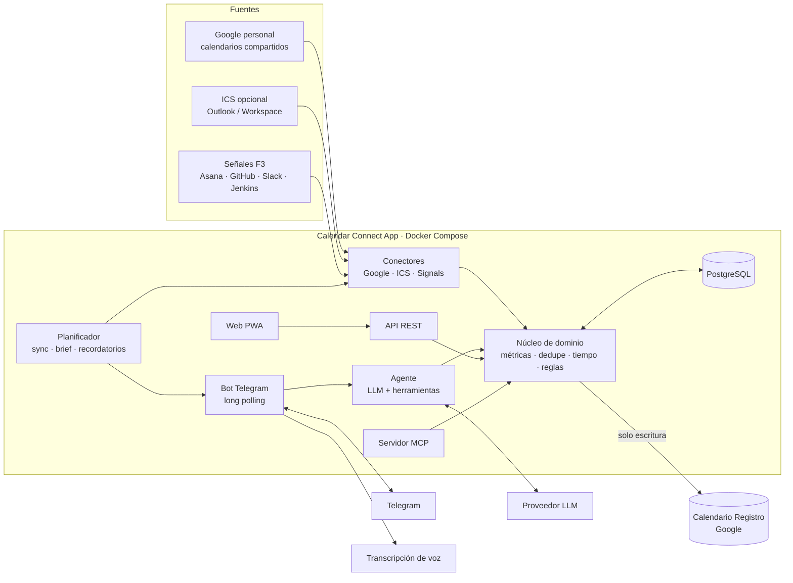
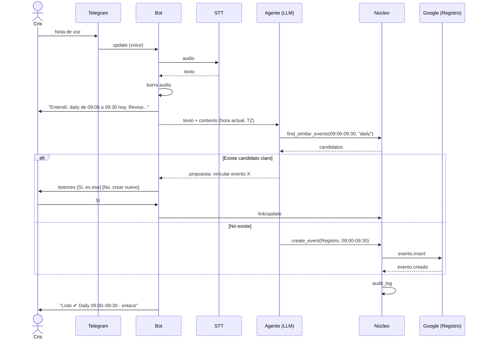

# 06 · Arquitectura

## 1. Principios

- **KISS:** un solo servicio de dominio, pocas piezas móviles; lo complejo se difiere.
- **Núcleo puro:** las reglas (métricas, dedupe, interpretación de rangos) no dependen de Google, Telegram ni del LLM.
- **Puertos y adaptadores:** cada integración es un adaptador intercambiable (SOLID: inversión de dependencias).
- **El LLM interpreta, el código calcula.** Los números nunca los inventa el modelo.
- **Mínimo privilegio y confirmación humana** para toda escritura destructiva.

## 2. Vista general



## 3. Flujo clave: "acabo de tener un daily de 9 a 9:30"



## 4. Modelo de datos (PostgreSQL)

| Tabla               | Campos principales                                                                                                                                                                                                                                | Notas                                         |
| ------------------- | ------------------------------------------------------------------------------------------------------------------------------------------------------------------------------------------------------------------------------------------------- | --------------------------------------------- |
| `oauth_credentials` | id, provider, account_email, `refresh_token_enc`, scopes, created_at, updated_at                                                                                                                                                                  | Cifrado AES-256-GCM                           |
| `calendars`         | id, source (`google`/`ics`), external_id, name, category, enabled, is_write_target, `sync_token`, `ics_url_enc`, last_synced_at                                                                                                                   | Un solo `is_write_target = true` ("Registro") |
| `events`            | id, calendar_id, external_id, ical_uid, `canonical_key`, title, start_utc, end_utc, all_day, status, response_status, attendees_count, has_conference_link, transparency, is_meeting, location, description_excerpt, source_updated_at, raw jsonb | Índices: (start_utc, end_utc), canonical_key  |
| `settings`          | key, value jsonb                                                                                                                                                                                                                                  | Horario laboral, TZ, brief, umbrales, reglas  |
| `pending_actions`   | id, type, payload jsonb, status, chat_id, expires_at                                                                                                                                                                                              | Confirmaciones (modificar/eliminar/vincular)  |
| `reminders`         | id, text, fire_at_utc, status, source_event_id                                                                                                                                                                                                    | Persisten tras reinicios                      |
| `processed_updates` | telegram_update_id (PK), processed_at                                                                                                                                                                                                             | Idempotencia (RNF-21)                         |
| `audit_log`         | id, ts, actor (`bot`/`web`/`mcp`/`system`), action, payload jsonb, result                                                                                                                                                                         | Toda escritura                                |
| `llm_usage`         | id, ts, provider, model, input_tokens, output_tokens, est_cost                                                                                                                                                                                    | Control de presupuesto                        |

`canonical_key` = `iCalUID` si existe; si no, hash de `normalize(title) + start_utc(redondeado a 5 min)`. Eventos con la misma clave son **el mismo evento** (RN-2).

## 5. Algoritmos

### 5.1 Regla de reunión (RF-09)

```
es_reunion(e) =
  e.status != 'cancelled'
  AND NOT e.all_day
  AND e.response_status != 'declined'
  AND e.transparency == 'opaque'
  AND (e.attendees_count >= 2 OR e.has_conference_link OR coincide_palabra_clave(e.title))
```

### 5.2 Horas de reunión (RF-10)

1. Seleccionar eventos canónicos que cumplen `es_reunion` y caen en el rango.
2. Recortar cada intervalo al rango consultado y al día en America/Bogota.
3. **Unir intervalos solapados** (merge) y sumar la duración de la unión (RN-3).
4. Repetir por categoría para el desglose.

### 5.3 Bloques libres (RF-11)

1. Intervalo de trabajo del día (p. ej., 08:00–18:00).
2. Restar la unión de **todos** los eventos ocupados (no solo reuniones), añadiendo el _buffer_ a cada lado.
3. Quedarse con huecos ≥ umbral (90 min por defecto).
4. Entregar lista ordenada y el hueco mayor.

### 5.4 Detección de duplicados al registrar (RF-17)

Para el rango propuesto `[s, e]` y el título `t`:

- **Candidatos:** eventos con solape ≥ 50 % del más corto, **o** |inicio − s| ≤ 15 min y |fin − e| ≤ 15 min.
- **Similitud de título:** `max(Jaccard de tokens normalizados, 1 − Levenshtein normalizado) ≥ 0.6`. Se normaliza sin tildes, minúsculas y sin palabras vacías.
- **Decisión:**
  - Candidato + título similar → _duplicado probable_ → preguntar si es el mismo y vincular.
  - Candidato + título distinto → _conflicto_ → preguntar.
  - Sin candidatos → crear en "Registro".
- Los eventos creados llevan `extendedProperties.private.cca_source = "voice" | "text" | "mcp"` y el `update_id` de origen.

### 5.5 Interpretación de tiempo (RNF-32)

- Se resuelve en el **agente** con la fecha/hora actual y la zona America/Bogota como contexto.
- La salida es estructurada (`start`, `end`, `confidence`); si `confidence` es baja o falta un dato, **se pregunta**.
- La validación final (fin > inicio, duración razonable) la hace el núcleo, no el LLM.

## 6. Herramientas del agente / MCP

| Herramienta           | Entrada                    | Efecto                 | Confirmación                  |
| --------------------- | -------------------------- | ---------------------- | ----------------------------- |
| `list_events`         | rango, categorías          | Lectura                | No                            |
| `get_metrics`         | rango, agrupación          | Lectura (determinista) | No                            |
| `find_free_blocks`    | día, mínimo                | Lectura                | No                            |
| `find_similar_events` | rango, título              | Lectura                | No                            |
| `create_event`        | título, inicio, fin, notas | Escribe en "Registro"  | Si hay conflicto o ambigüedad |
| `update_event`        | id, cambios                | Solo "Registro"        | **Siempre**                   |
| `delete_event`        | id                         | Solo "Registro"        | **Siempre**                   |
| `get_brief`           | fecha                      | Lectura                | No                            |
| `create_reminder`     | texto, momento             | Escribe en BD          | No                            |

## 7. Estructura del repositorio (monorepo pnpm)

```
calendar-connect-app/
├─ apps/
│  ├─ api/            # API REST + planificador + OAuth callbacks
│  ├─ bot/            # Telegram (long polling), STT, orquestación del agente
│  ├─ mcp/            # Servidor MCP
│  └─ web/            # PWA (Next.js o Vite + React)
├─ packages/
│  ├─ core/           # Dominio puro: métricas, dedupe, tiempo, reglas (sin I/O)
│  ├─ connectors/     # google, ics, signals/* (asana, github, slack, jenkins)
│  ├─ agent/          # Interfaz LlmProvider + herramientas + prompts
│  ├─ db/             # Esquema, migraciones, repositorios
│  └─ shared/         # Tipos, utilidades, cifrado, logger
├─ docs/              # Estos documentos
├─ docker/            # Dockerfiles y compose
├─ .github/workflows/ # CI/CD
├─ .env.example
└─ pnpm-workspace.yaml
```

Reglas de dependencia: `core` no importa a nadie; `connectors`, `agent` y `db` dependen de `core`; las `apps` componen todo.

## 8. Stack tecnológico propuesto

| Capa             | Elección                                                    | Motivo                                                     |
| ---------------- | ----------------------------------------------------------- | ---------------------------------------------------------- |
| Lenguaje         | TypeScript (strict) en Node LTS                             | Un solo lenguaje de punta a punta                          |
| API              | Fastify (o Hono) + Zod                                      | Ligero, validación de esquemas                             |
| Bot              | grammY                                                      | Maduro, buen soporte de long polling                       |
| BD               | PostgreSQL + Drizzle (o Prisma)                             | Relacional, migraciones versionadas                        |
| Planificador     | `node-cron` + tabla de recordatorios                        | Sin infraestructura extra (KISS)                           |
| Web              | React (Vite o Next.js) + PWA                                | Instalable en móvil                                        |
| Pruebas          | Vitest + Testcontainers + mocks de proveedores              | Núcleo rápido, integración realista                        |
| Contenedores     | Docker Compose                                              | `docker compose up`                                        |
| CI/CD            | GitHub Actions                                              | Lint, test, escaneo de secretos, build de imagen           |
| Automatizaciones | **n8n** (opcional, fase 3) y **Python** (scripts puntuales) | Para integraciones de bajo riesgo; no en el camino crítico |
| Acceso           | Tailscale o Cloudflare Tunnel                               | Sin puertos públicos                                       |

## 9. Composición Docker (boceto)

```yaml
services:
  db:
    image: postgres:16
    restart: unless-stopped
    environment:
      POSTGRES_DB: cca
      POSTGRES_USER: cca
      POSTGRES_PASSWORD: ${POSTGRES_PASSWORD}
    volumes: [dbdata:/var/lib/postgresql/data]
    healthcheck:
      test: ["CMD-SHELL", "pg_isready -U cca"]
  api:
    build: { context: ., dockerfile: docker/api.Dockerfile }
    env_file: .env
    depends_on: { db: { condition: service_healthy } }
    ports: ["127.0.0.1:3000:3000"]
    restart: unless-stopped
  bot:
    build: { context: ., dockerfile: docker/bot.Dockerfile }
    env_file: .env
    depends_on: [api]
    restart: unless-stopped
  backup:
    image: prodrigestivill/postgres-backup-local
    environment: { POSTGRES_HOST: db, POSTGRES_DB: cca, POSTGRES_USER: cca, POSTGRES_PASSWORD: ${POSTGRES_PASSWORD}, SCHEDULE: "@daily", BACKUP_KEEP_DAYS: 14 }
    volumes: [./backups:/backups]
volumes:
  dbdata:
```

## 10. Modelo de amenazas (resumen)

| Amenaza                                                                                  | Impacto                                | Control                                                                                                                                          |
| ---------------------------------------------------------------------------------------- | -------------------------------------- | ------------------------------------------------------------------------------------------------------------------------------------------------ |
| Filtración del token del bot                                                             | Terceros escriben al bot               | Allowlist por `chat_id`; rotación con `/revoke`                                                                                                  |
| Robo de refresh token de Google                                                          | Lectura de agenda                      | Cifrado en reposo; scopes mínimos; revocar en cuenta Google                                                                                      |
| **Inyección de instrucciones** en título/descripción de un evento (invitación maliciosa) | El agente podría ser inducido a actuar | Contenido tratado como dato; acciones destructivas con confirmación; sin herramientas de exfiltración; escritura limitada a "Registro" por scope |
| Exposición de la web                                                                     | Acceso a la agenda                     | Red privada + autenticación; sin puertos públicos                                                                                                |
| Fuga de datos al LLM                                                                     | Privacidad de reuniones de trabajo     | Minimización y ocultación de títulos por categoría                                                                                               |
| Pérdida de `APP_ENCRYPTION_KEY`                                                          | No se pueden descifrar tokens          | Copia en gestor de contraseñas; reautorización como plan B                                                                                       |
| Reprocesar mensajes de Telegram                                                          | Eventos duplicados                     | Tabla `processed_updates` (idempotencia)                                                                                                         |

## 11. Evolución prevista

1. **v0.4:** adaptador ICS y servidor MCP sobre el mismo núcleo.
2. **F3:** interfaz `SignalSource` para Asana, GitHub, Slack y Jenkins; n8n puede orquestar webhooks hacia la API.
3. **Microsoft Graph:** adaptador de escritura adicional si el administrador concede consentimiento.
4. Si el volumen crece: mover el planificador a una cola (BullMQ + Redis). No antes.
